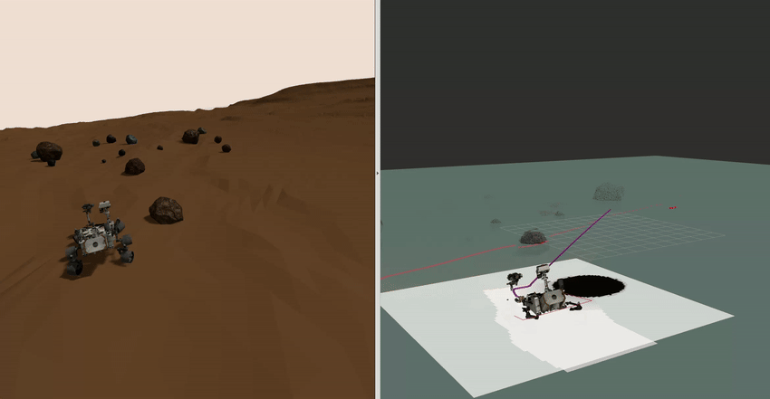
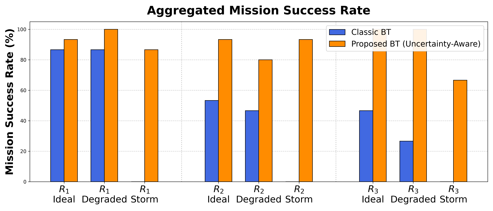

# Risk-Aware Mars Rover Navigation (ROS 2 Jazzy)

This project presents the results of master's thesis Integration of Uncertain Neural Perception with Behavior Trees for Safe Decision-Making in Autonomous Wheeled Mobile Robots for Exploration Missions. Decision-making system is based on Behavior Tree architecture and obstacle risk-based derivation that determine the final rover decision. This repository includes all important codes for the proposed decision-making system for an autonomous mobile rover.  

<p align="center">
  
</p>

## System Architecture: Proposed vs. Classic Baseline

<p align="center">
  
</p>

* **Classic Baseline (`Classic BT`):** Relies on raw uncalibrated detections and deterministic distance thresholds without accounting for uncertainty of perception.
* **Proposed Risk-Aware System (`Proposed BT`):** Calibrates neural perception confidence (Platt scaling) and combines collision probability ($P_{\text{col}}$) with obstacle collision severity to dynamically modulate Behavior Tree decisions under nominal (`ideal`), noisy (`gauss`), and degraded (`storm`) conditions.


## Repository Structure

```text
src/
├── rover_interfaces/        # Custom ROS 2 message and service definitions
├── rover_perception_pkg/    # YOLOv8 hazard detection and uncertainty estimation node
├── rover_navigation_pkg/    # Nav2 configuration and Behavior Tree autonomy variants
├── rover_autonomy_pkg/      # Proposed decision-making algorithm and other tested variants
├── rover_experiments_pkg/   # Single-run simulation manager and experiment metrics logger
├── curiosity_description/   # Space ROS Curiosity rover model
├── curiosity_gazebo/        # Space ROS Curiosity rover Gazebo simulation configuration
└── curiosity_rover_demo/    # Space ROS Demo control nodes
```

## Prerequisites

* **OS:** Ubuntu 24.04 LTS
* **ROS 2:** Jazzy Jalisco (with Gazebo Sim and Nav2)
* **Python:** 3.12+

## Installation & Build

1. **Create a ROS 2 workspace and clone this repository into `src/`:**
   ```bash
   mkdir -p ~/ros2_ws
   cd ~/ros2_ws
   git clone https://github.com/GerardWs189783/Risk-Aware-Decision-Making-System src
   ```

2. **Install ROS 2 system dependencies via `rosdep`:**
   ```bash
   sudo rosdep init 2>/dev/null || true
   rosdep update
   rosdep install --from-paths src --ignore-src -r -y
   ```

3. **Install Python dependencies:**
   ```bash
   pip install -r src/requirements.txt
   ```
   *(If Ubuntu 24.04 blocks system-wide `pip`, either use a virtual environment or pass `--break-system-packages`.)*

4. **Build the workspace:**
   ```bash
   cd ~/ros2_ws
   colcon build --symlink-install
   source install/setup.bash
   ```

## Running Simulations

Use `simulation_run_manager.py` to launch Gazebo, YOLOv8 perception, Nav2, the Behavior Tree controller, and the rover control bridge in a single command:

```bash
source ~/ros2_ws/install/setup.bash
python3 ~/ros2_ws/src/rover_experiments_pkg/scripts/simulation_run_manager.py
```

### CLI Options

| Flag | Options | Default | Description |
| :--- | :--- | :--- | :--- |
| `--variant` | `uncertainty_aware`, `classic`, `no_platt`, `no_pcol`, `no_severity` | `uncertainty_aware` | Behavior Tree decision-making architecture |
| `--scenario` | `ideal`, `gauss`, `storm` | `ideal` | Environmental & camera noise condition |
| `--map` | `easy`, `medium`, `hard` | `medium` | Obstacle world difficulty |
| `--wp` | `wp1`, `wp2`, `wp3` | `wp2` | Spawn and waypoint route preset |
| `--headless` | *(flag)* | `false` | Run Gazebo headless and disable RViz2 |
| `--no-nvidia` | *(flag)* | `false` | Disable NVIDIA PRIME render offload (use Intel/Mesa) |
| `--log-metrics` | *(flag)* | `false` | Record mission telemetry to CSV and exit on completion |
| `--run-id` | `<int>` | `1` | Run identifier when `--log-metrics` is enabled |

### Example Runs

```bash
# Headless benchmark run with automated metrics logging
python3 ~/ros2_ws/src/rover_experiments_pkg/scripts/simulation_run_manager.py \
  --variant uncertainty_aware --scenario storm --map hard --wp wp3 \
  --headless --log-metrics --run-id 1

# Classical baseline comparison with GUI
python3 ~/ros2_ws/src/rover_experiments_pkg/scripts/simulation_run_manager.py \
  --variant classic --scenario gauss --map medium --wp wp2
```

## License

Custom `rover_*` packages are licensed under the **Apache License 2.0** (see `LICENSE`). Third-party Space ROS packages retain their original licenses.